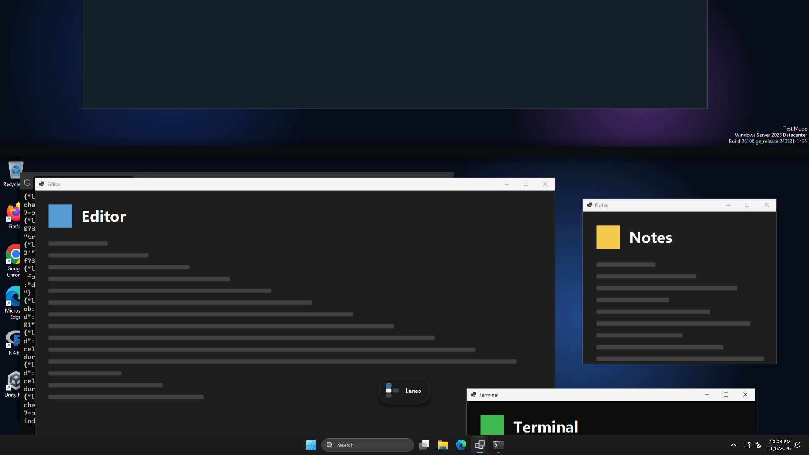

# Lanes

Lanes of virtual desktops on Windows 11, one above the other, moved between with
four-finger swipes that follow your fingers, and an overview of every lane on a
three-finger swipe up. Made for an Apple Magic Trackpad; works with any precision touchpad.



## What it does

Windows keeps desktops in one row, and only its own left/right swipe follows the fingers.
Lanes arranges them in rows — lanes — one above the other, and draws the swipe itself, so
it works in all four directions:

| Swipe | What happens |
| --- | --- |
| 4 fingers left / right | The next or previous desktop in the same lane |
| 4 fingers down / up | The lane above / below, on the desktop you last used there |
| 3 fingers up | The overview: every lane, and this desktop's windows spread out |
| 3 fingers down | Closes the overview |

Each lane remembers where you were. Say Messages lives in the lane above: from any desktop
of your lane, a swipe down brings Messages. Go down to the lane below, open a code agent
there, swipe over to a video, swipe up — you are back where you left your lane, and
Messages is still above.

The picture moves with the fingers the whole way: stop halfway and it stays, move back and
it comes back, and the switch happens only when you let go past the middle or flick. Where
there is no desktop (the end of a lane, above the top lane) the picture stretches a little
and springs back. While you swipe, a small pill near the bottom shows the lanes and where
you are going.


"Content follows fingers" in the tray menu is on by default, as in Windows' own swipe:
fingers down pull the lane above into view. Turn it off to swap up and down.

On first start Lanes puts all your desktops in one lane and makes one new desktop above and
one below.

### The overview

A three-finger swipe up opens it, again following the fingers: the windows travel from
where they are into a spread, and the lanes come down above them. Each lane's row is shifted
so that the desktop a swipe up or down would land on sits in one column with the desktop you
are on, in the middle: what is above and below you reads at a glance.


- **Click a window** to bring it to the front and close the overview.
- **Click a desktop** to go there; the overview zooms into it.
- **Click +** at the end of a lane to make a new desktop there; **New lane** under the last
  lane starts a new lane.
- **Right-click a desktop** to move it to the lane above or below, to a new lane, left or
  right, or to close it. A lane left without desktops goes away.
- **Esc**, a click on empty space or **three fingers down** close it.

The blue ring is the desktop you are on; a blue dot after a name marks the desktop each lane
will open on.

### Tray menu


- **Gestures** — off gives the swipes back to Windows until you turn it on again.
- **Content follows fingers** — see above.
- **Show all lanes** — the overview, without a swipe.
- **Open log**, **Restart**, **Quit**. Quitting gives the swipes back to Windows.
- **Update to X** appears when a newer release is out.

(The screenshots come from the CI machine: test windows, all named "Lanes".)

## Install

Requires Windows 11 (tested on 24H2 and 26H2), the
[.NET 8 Desktop Runtime](https://dotnet.microsoft.com/download/dotnet/8.0), and a
precision touchpad. A Magic Trackpad becomes one with the
[mac-precision-touchpad](https://github.com/imbushuo/mac-precision-touchpad) driver.

Download `Lanes.exe` from the [latest release](https://github.com/iliyasone/lanes/releases/latest)
and run `Lanes.exe --install` (it asks for administrator rights). It copies itself to
`C:\Program Files\Lanes` and starts with Windows through a Task Scheduler task that runs
elevated, so swipes also work while an administrator window is in front.

It sets Windows' own four-finger swipes and three-finger up/down to
*Nothing* (Settings → Bluetooth & devices → Touchpad → Advanced gestures) so the two never
react to the same swipe, and puts back what you had when it quits. Three-finger
left/right and taps stay with Windows.

`Lanes.exe --uninstall` stops it, gives the gestures back (and tells Windows to use them
again at once), removes the desktops Lanes made — their windows move to one of yours — and
removes Lanes. The log and settings stay in `%LOCALAPPDATA%\Lanes`.

## Updates

Lanes checks GitHub Releases 30 seconds after start and every 4 hours. When there is a
newer version the tray icon gets a blue dot and the menu shows **Update to X**: it
downloads the new `Lanes.exe`, swaps it in and restarts. Nothing is downloaded until you
click it.

## Files

`%LOCALAPPDATA%\Lanes\`:

- `log.txt` — start-up, touchpads found, every swipe with where it was let go and how the
  touchpad reported it, frame timings after each animation, errors;
- `lanes.json` — which desktop is in which lane (by Windows' desktop ID), where each lane
  was last, and which desktops Lanes made;
- `settings.json` — the tray menu switches;
- `windows-gestures.txt` — your Windows gesture settings while Lanes holds them.

## Limits

- One monitor: the animation is drawn on the monitor under the pointer. On several monitors
  the others switch at once when the swipe ends.
- The pictures of other desktops are taken when you were last on them (every few seconds
  and at the start of each swipe), so a desktop you have not visited since Lanes started
  shows its wallpaper until you have been there once.
- Windows keeps its own copy of the gesture settings; Lanes tells it to reload them through
  the same undocumented interface the Settings app uses. If a future Windows breaks that,
  open Settings → Touchpad once and Windows reloads them.
- Windows' own Task View and Ctrl+Win+arrows still see one row of desktops.
- After a switch Windows shows its own "Desktop N" label at the bottom for about two
  seconds, as after its own swipe. It is not a window Lanes can hide; naming desktops in
  Task View makes it say something useful.

## How it works

- `src/Lanes.Core` (no Windows dependencies, unit-tested in `tests/`): `Gestures.cs` turns
  touchpad reports into swipes, following each finger by its contact ID so a finger
  landing late or lifting early does not make the picture jump; `Motion.cs` maps finger
  travel to the picture and decides where it goes on release, then moves it with a
  critically damped spring that starts at the fingers' speed; `LaneMap.cs` keeps the
  lanes; `Spread.cs` lays out the overview.
- `src/Lanes`: `Touchpad.cs` reads raw HID reports; `Engine*.cs` runs everything a swipe
  needs on one thread: each frame is drawn right after the freshest report with Direct2D
  on a flip-model swap chain (`Gfx.cs`) in a topmost window shown on every desktop and
  left out of screen captures (`Overlay.cs`). When the swipe ends on another desktop,
  Lanes switches to it underneath the picture and then removes the picture. The overview's
  windows are live DWM thumbnails. Work that must happen in your own session without
  elevation (telling Explorer to reload gesture settings, removing desktops on uninstall)
  runs through a second task, `Lanes session` (`SessionHelper.cs`). `Desktops.cs` talks to Windows' virtual desktops through
  [VirtualDesktopAccessor](https://github.com/Ciantic/VirtualDesktopAccessor) (embedded).
- CI (`.github/workflows/ci.yml`) runs `Lanes.exe --demo` on a Windows runner set to dark
  theme at 1920×1080: it sets up desktops with sample windows, performs the swipes with
  made-up touchpad reports, checks that clicks pass through Lanes' window between swipes,
  and uploads screenshots and the log. It then installs Lanes, checks it runs and holds the
  swipes, uninstalls it and checks the gestures and desktops are back. The runner has no
  GPU and no touchpad, so how a swipe feels is checked on a real machine.

## Build

```sh
dotnet test tests/Lanes.Tests
dotnet publish src/Lanes -c Release -r win-x64 --self-contained false -p:PublishSingleFile=true -o out
```

Builds on Linux too (`EnableWindowsTargeting`). A release is a tag `vX.Y.Z` matching
`<Version>` in `src/Lanes/Lanes.csproj`; `.github/workflows/release.yml` builds and
publishes it.

The first mockups are in `docs/design/` (`mock.html`, rendered by `render.sh`); the overview
has since moved to one column of current desktops without lane names.
