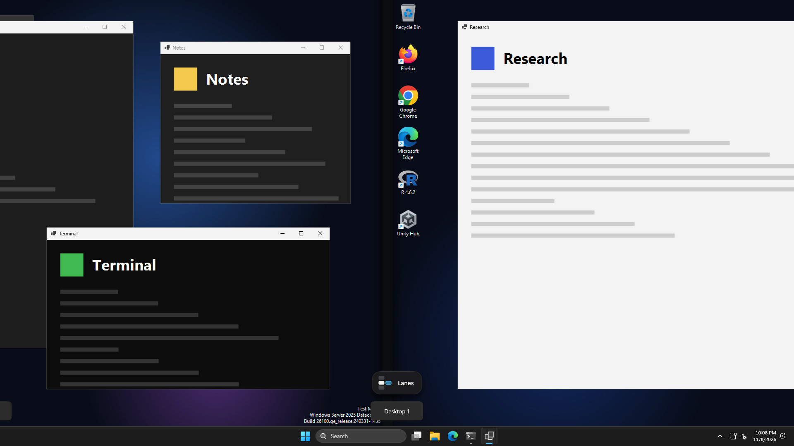
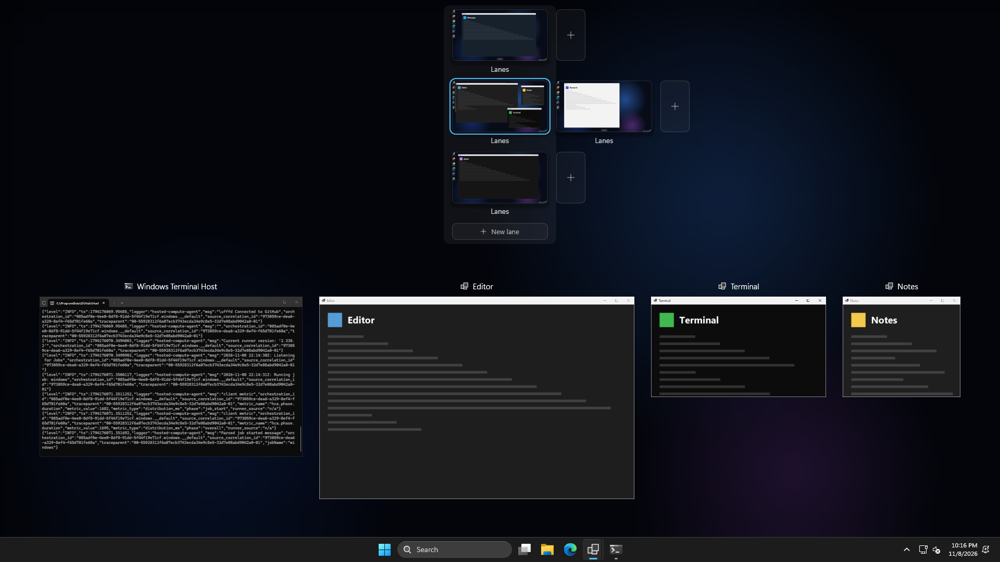
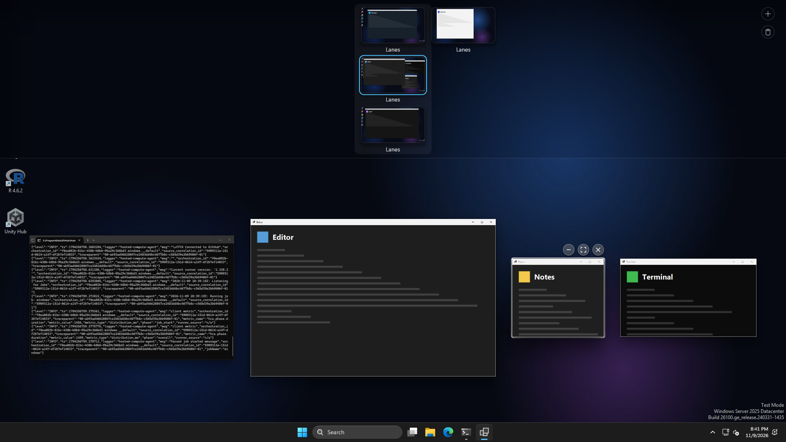
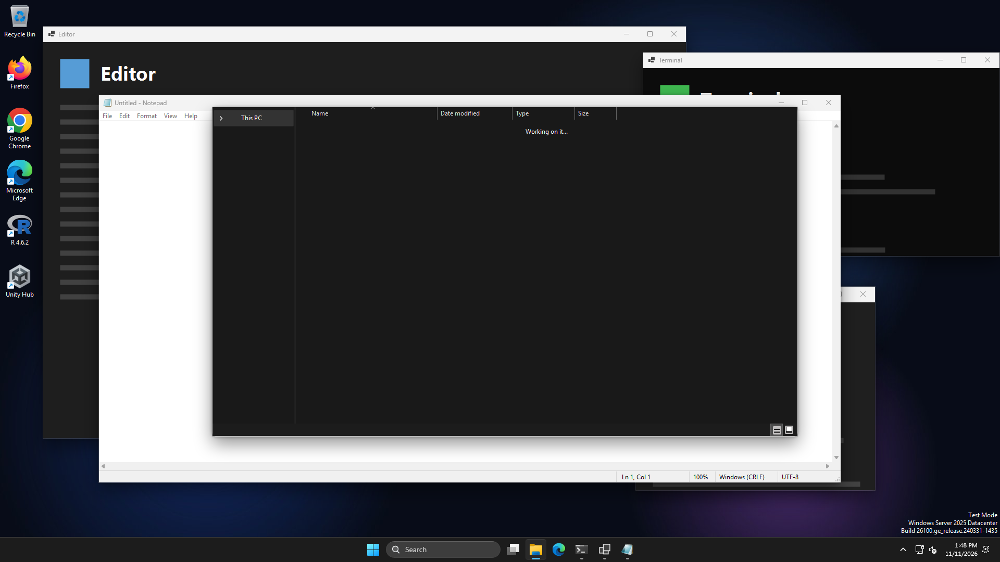
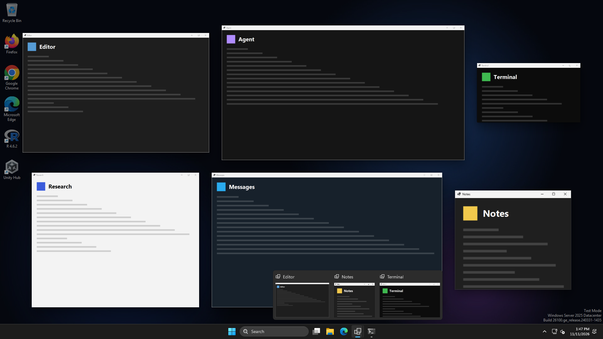
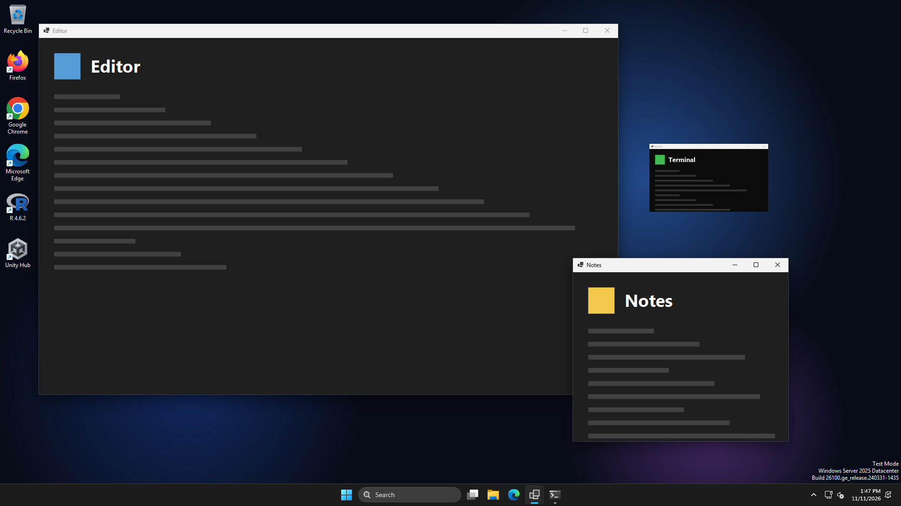
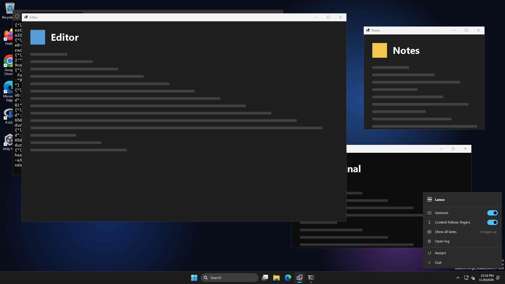

# Lanes

Lanes of virtual desktops on Windows 11, one above the other, moved between with
four-finger swipes that follow your fingers, and an overview of every lane on a
three-finger swipe up. Made for an Apple Magic Trackpad; works with any precision touchpad.


## What it does

Windows keeps desktops in one row, and only its own left/right swipe follows the fingers.
Lanes arranges them in rows — lanes — one above the other, and draws the swipe itself, so
it works in all four directions:

| Swipe | What happens |
| --- | --- |
| 4 fingers left / right | The next or previous desktop in the same lane |
| 4 fingers down / up | The lane above / below, on the desktop you last used there |
| 3 fingers up | The overview: every lane, and this desktop's windows spread out |
| 3 fingers down | Closes the overview |
| 4 fingers in the overview | The next desktop or lane, and the overview stays open |

Each lane remembers where you were. Say Messages lives in the lane above: from any desktop
of your lane, a swipe down brings Messages. Go down to the lane below, open a code agent
there, swipe over to a video, swipe up — you are back where you left your lane, and
Messages is still above.

The picture moves with the fingers the whole way: stop halfway and it stays, move back and
it comes back, and the switch happens only when you let go past the middle or flick. Where
there is no desktop (the end of a lane, above the top lane) the picture stretches a little
and springs back, lifted off a plain backdrop with a short shadow at its edge.

A full-screen window lies over the taskbar, as on the screen: swiping away from it, the
taskbar comes out from under the window with the window's light shadow on it, which goes as
the window's edge leaves the taskbar and as the desktops come to rest.

At the bottom, in the place of Windows' "Desktop N" pill (which Lanes keeps away), a small
map of the lanes rises in, moves with the fingers and stays as long as Windows' pill would,
then goes down out of sight (or with the fingers, if they open the overview first): the blue
cell is where you are and your lane stands out from the others; a sideways swipe slides your
lane under the blue cell, one up or down carries it to the next lane. The map, like Windows'
pop-ups, is light or dark as Windows is (Settings → Personalization → Colors). When Windows'
volume or brightness pop-up shows in the same place, the map glides aside, and back once the
pop-up has gone.

### Window shadows

App windows on the desktop cast a shadow as on a Mac: a soft one well below the window and a
short dark one tight round its edges, deeper than Windows' own thin one. The overview shows
the same shadow, over the windows behind too, so nothing changes about it as the overview
opens. Lanes keeps four
see-through windows of its own round each app window, just under it, which clicks pass
through and which follow the window as it moves (while it is dragged the shadow can be a
frame behind). Maximized and full-screen windows, and windows kept on top of the others,
have none.

Windows switches the moment you let go, under the picture, so by the time the picture lands
the new desktop is drawn, wallpaper included.



"Content follows fingers" in the tray menu is on by default, as in Windows' own swipe:
fingers down pull the lane above into view. Turn it off to swap up and down.

On first start Lanes puts all your desktops in one lane and makes one new desktop above and
one below. It also turns on Windows' "Show all open windows on the taskbar: on all desktops"
(Settings → System → Multitasking), so the taskbar keeps every app whatever desktop you are
on, as the Dock does on a Mac; clicking an app that is on another desktop takes you there.
If you change that setting later, Lanes leaves it as you set it.

### The overview

A three-finger swipe up, or Win+Tab, opens it, again following the fingers: the windows travel from
where they are into rows, as large as the room below the lanes allows (never larger than
they are), each about where it was, and the lanes come down above them. Smaller windows
shrink less than big ones, and a small one keeps its size where its row has room. Each window
casts a shadow, the same as on the desktop, which grows and deepens under the pointer. Over a
full-screen window the taskbar slides in from the screen's edge as the overview opens and back
out as it closes; while it is open the taskbar is the active window, which Windows keeps in
front of the full-screen one, so it takes clicks as it does anywhere else (the full-screen
window is active again after, unless you picked another). Each lane's row is shifted
so that the desktop a swipe up or down would land on sits in one column with the desktop you
are on, in the middle: what is above and below you reads at a glance.



- **Four fingers** move to the next desktop or lane as they do outside it, and the overview
  stays: the windows of the next desktop slide in with the fingers, your lane slides under
  the blue ring (or the ring moves to the next lane), and Windows switches when you let go.
- **Drag a desktop** to another place in its lane or into another lane. As you pick it up,
  thin bars come in on every side: above the top lane and below the bottom one (a **New
  lane**) and at both ends of each lane. Wherever you hold it, its place opens: the desktops
  beside it move apart, or the lanes below a new lane move down and the band grows, and a
  blue block grows where it will go. A lane left without desktops goes away.
- **Drag a window** onto a desktop to move it there (it shrinks into that desktop's
  picture). Held over a bar, at a lane's end or above or below the lanes, it opens a place
  there for a new desktop (or lane) with it, the same way; held a moment by the gap between
  two desktops, it opens one between them. **+** also takes it, for a new desktop at the end
  of your lane. Held over another window of the same desktop, that window moves over to its
  place; let go, and the two change places on the desktop, each keeping its size (one against
  an edge of the screen goes against the same edge in the other's place). A window let go
  anywhere else springs back to its place. The window you dragged comes to the front as the
  overview closes.
- **The window under the pointer** is outlined and gets three round buttons over its top right
  corner, as on its title bar (which in the overview is only a picture): minimize (it flies
  into its app's taskbar button), full screen, as the green button on a Mac (the window loses
  its frame and covers the whole screen and the taskbar; a browser, or an app built on one,
  goes into its own full screen instead, as by F11, without its tabs and address bar; it goes to a new desktop of its own,
  next to the one it was on, where Lanes takes you; pressed again in the overview there, it
  comes back as it was to the desktop it came from, and the desktop made for it goes, as it
  does when the window is closed), and close.


- **Middle-click** a window to close it, or a desktop to close the desktop (its windows go to
  the desktop next to it), as in Task View.
- **Click a window** to bring it to the front and close the overview; **click a desktop** to
  go there (the overview zooms into it); **click +** for a new desktop at the end of your lane.
- **Esc**, a click on empty space or **three fingers down** close it.

The icons on your desktop stay where they are as the fingers start and fade as the overview
opens.


The blue ring is the desktop you are on; the column it stands in holds, in every lane, the
desktop a swipe up or down lands on.

### Alt+Tab

Alt+Tab works as Cmd+Tab on a Mac: it goes between apps, not windows. Held a moment, it shows
a row of large app icons in the middle of the screen, with the name of the one picked under it.
The row has every app with a window on any desktop, minimized ones too, in the order you last
used them, so the first Tab picks the app you were in before. Each Tab moves one to the right
and round from the end, Shift+Tab or the arrow keys go either way, and Alt+Shift+Tab picks the
last one. Let go of Alt and the app's window you used last comes to the front, on its own
desktop if it is on another (Lanes takes you there), or out of its taskbar button onto this
desktop if it is minimized; Esc puts the row away. A quick Alt+Tab switches without the row
showing. The row is light or dark as Windows is, and its icons get smaller only when there are
more apps than fit across the screen.



### An app's windows

A click on the taskbar button of an app with several windows shows them all, as the overview
does but without the lanes: each window large, about where it is on the screen, over a darkened
desktop, while the other windows here fade away. They come from every desktop: those of other
desktops fade in, and minimized ones rise out of the taskbar button. Click one to go to it: a
window of another desktop takes you there, and a minimized one grows back into its place here.
A click on the same button again, Esc, or a click on empty space closes it.

An app with one window works as Windows has it (the click brings it to the front, or minimizes
it when it is in front), except that a minimized window comes back to the desktop you are on.



### Minimizing

A window minimized any way (its own button, the taskbar, Win+Down) flies into its app's
taskbar button: it shrinks at once and travels as it does, faster as it goes, and fades only in
the button. When Lanes brings it back (the taskbar, Alt+Tab, an app's windows) it flies out of
the button the same way backwards, onto the desktop you are on: minimized, a window has left its
desktop, as on a Mac. Lanes turns Windows' own animation off for this ("Animate windows when
minimizing and maximizing", in System Properties → Performance), so maximizing is instant while
Lanes runs; quitting puts the setting back.



### Tray menu



It opens against the taskbar, wherever the taskbar is.

- **Gestures** — off gives the swipes back to Windows until you turn it on again.
- **Content follows fingers** — see above.
- **Show all lanes** — the overview, without a swipe.
- **Open log**, **Restart**, **Quit**. Quitting gives the swipes back to Windows.
- **Update to X** appears when a newer release is out.

(The screenshots come from the CI machine: test windows, all named "Lanes".)

## Install

Requires Windows 11 (tested on 24H2 and 26H2), the
[.NET 8 Desktop Runtime](https://dotnet.microsoft.com/download/dotnet/8.0), and a
precision touchpad. A Magic Trackpad becomes one with the
[mac-precision-touchpad](https://github.com/imbushuo/mac-precision-touchpad) driver.

Download `Lanes.exe` from the [latest release](https://github.com/iliyasone/lanes/releases/latest)
and run `Lanes.exe --install` (it asks for administrator rights). It copies itself to
`C:\Program Files\Lanes` and starts with Windows through a Task Scheduler task that runs
elevated, so swipes also work while an administrator window is in front. It also adds **Lanes** to
Start: search for it to start Lanes again after you quit it (it starts through the same task,
without a prompt; if Lanes is already running, nothing happens).

It sets Windows' own four-finger swipes and three-finger up/down to
*Nothing* (Settings → Bluetooth & devices → Touchpad → Advanced gestures) so the two never
react to the same swipe, and puts back what you had when it quits. Three-finger
left/right and taps stay with Windows.

`Lanes.exe --uninstall` stops it, gives the gestures and the taskbar setting back (and
tells Windows to use them again at once), removes the desktops Lanes made — their windows move to one of yours — and
removes Lanes and its Start entry. The log and settings stay in `%LOCALAPPDATA%\Lanes`.

## Updates

Lanes checks GitHub Releases 30 seconds after start and every 4 hours. When there is a
newer version the tray icon gets a blue dot and the menu shows **Update to X**: it
downloads the new `Lanes.exe`, swaps it in and restarts. Nothing is downloaded until you
click it.

## Files

`%LOCALAPPDATA%\Lanes\`:

- `log.txt` — start-up, touchpads found, every swipe with where it was let go and how the
  touchpad reported it, frame timings after each animation, errors;
- `lanes.json` — which desktop is in which lane (by Windows' desktop ID), where each lane
  was last, and which desktops Lanes made;
- `settings.json` — the tray menu switches;
- `windows-gestures.txt` — your Windows gesture settings while Lanes holds them;
- `taskbar.txt` — the taskbar setting you had before Lanes turned it on;
- `window-animation.txt` — Windows' minimize animation setting while Lanes holds it.

## Limits

- One monitor: the animation is drawn on the monitor under the pointer. On several monitors
  the others switch at once when the swipe ends.
- The pictures of other desktops are taken when you were last on them (every few seconds
  and at the start of each swipe), so a desktop you have not visited since Lanes started
  shows its wallpaper until you have been there once.
- Windows keeps its own copy of the gesture settings; Lanes tells it to reload them through
  the same undocumented interface the Settings app uses. If a future Windows breaks that,
  open Settings → Touchpad once and Windows reloads them.
- Windows' own Task View and Ctrl+Win+arrows still see one row of desktops.
- A window that is on every desktop ("Show this window on all desktops") gets its shadow back
  a moment after each switch.
- The taskbar button of an app with several windows cannot be dragged to another place: Lanes
  takes the press. Windows' own row of thumbnails still comes up over such a button while
  the pointer rests on it, over the app's windows shown large too; it goes as the pointer leaves.
- A minimized window that comes back by itself (its app, a notification) appears at once, without
  flying out of the taskbar.

## How it works

- `src/Lanes.Core` (no Windows dependencies, unit-tested in `tests/`): `Gestures.cs` turns
  touchpad reports into swipes, following each finger by its contact ID so a finger
  landing late or lifting early does not make the picture jump; `Motion.cs` maps finger
  travel to the picture and decides where it goes on release, then moves it with a
  critically damped spring that starts at the fingers' speed; `LaneMap.cs` keeps the
  lanes; `Strip.cs` lays out the overview's lane rows and works out where a dragged desktop
  goes; `Spread.cs` lays out its windows; `Shadow.cs` works out a window's shadow, shared by
  the desktop and the overview.
- `src/Lanes`: `Touchpad.cs` reads raw HID reports; `Engine*.cs` runs everything a swipe
  needs on one thread: each frame is drawn right after the freshest report with Direct2D
  on a flip-model swap chain (`Gfx.cs`) in a topmost window shown on every desktop and
  shown in screenshots (`Overlay.cs`). When a swipe is let go toward another desktop, Lanes
  switches to it at once underneath the picture, and removes the picture once it has landed. The overview's
  windows are live DWM thumbnails, and so are their shadows (`ShadowSprite.cs`), so that a
  shadow lies over the windows behind it. Work that must happen in your own session without
  elevation (telling Explorer to reload gesture settings, removing desktops on uninstall)
  runs through a second task, `Lanes session` (`SessionHelper.cs`). `Desktops.cs` talks to Windows' virtual desktops through
  [VirtualDesktopAccessor](https://github.com/Ciantic/VirtualDesktopAccessor) (embedded).
  `DesktopShadows.cs` keeps the windows' shadows on the desktop on a thread of its own,
  told of every move by a WinEvent hook. `TaskbarButtons.cs` knows which button is whose and
  takes the clicks on an app's button; `Engine.Flights.cs` flies minimized windows into the
  taskbar and back, with Windows' own animation off (`WindowAnimation.cs`).
  `AltTab.cs` is Alt+Tab, on a thread of its own: it takes its keys from the Win+Tab
  keyboard hook (`WinTab.cs`), keeps the order apps were used in from a WinEvent hook, and
  draws its row of icons; `AppSwitch.cs` in `Lanes.Core` orders and groups the apps.
- CI (`.github/workflows/ci.yml`) runs `Lanes.exe --demo` on a Windows runner set to dark
  theme at 1920×1080: it sets up desktops with sample windows, performs the swipes with
  made-up touchpad reports, checks that clicks pass through Lanes' window between swipes,
  and uploads screenshots and the log. It then installs Lanes, checks it runs and holds the
  swipes, uninstalls it and checks the gestures and desktops are back. The runner has no
  GPU and no touchpad, so how a swipe feels is checked on a real machine.

## Build

```sh
dotnet test tests/Lanes.Tests
dotnet publish src/Lanes -c Release -r win-x64 --self-contained false -p:PublishSingleFile=true -o out
```

Builds on Linux too (`EnableWindowsTargeting`). A release is a tag `vX.Y.Z` matching
`<Version>` in `src/Lanes/Lanes.csproj`; `.github/workflows/release.yml` builds and
publishes it.

The first mockups are in `docs/design/` (`mock.html`, rendered by `render.sh`); the overview
has since moved to one column of current desktops without lane names.
